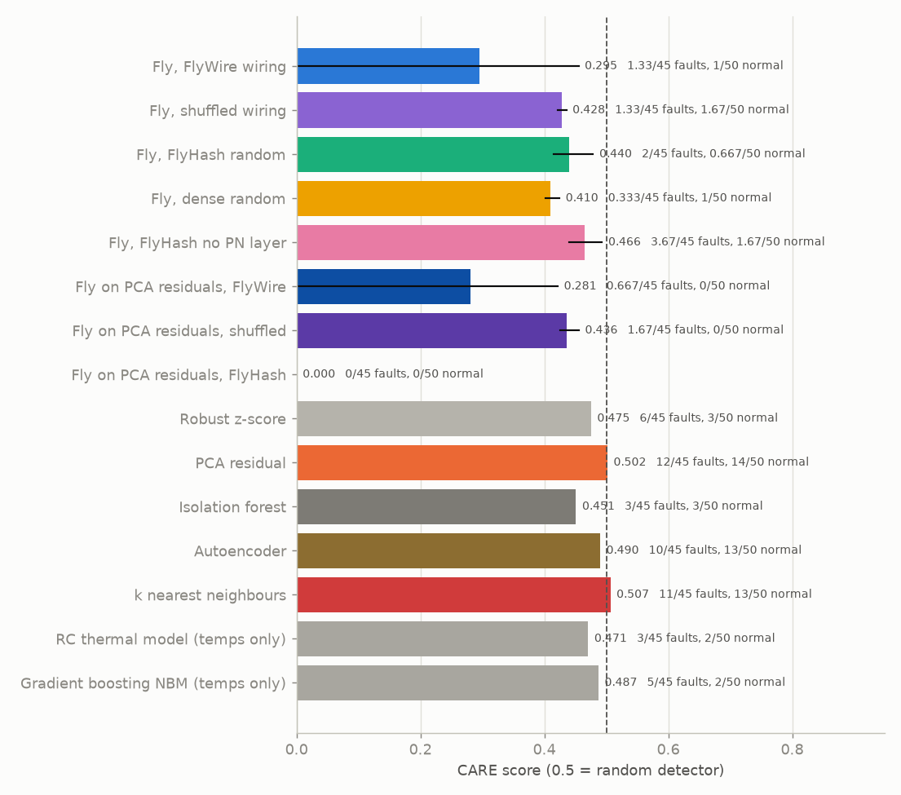
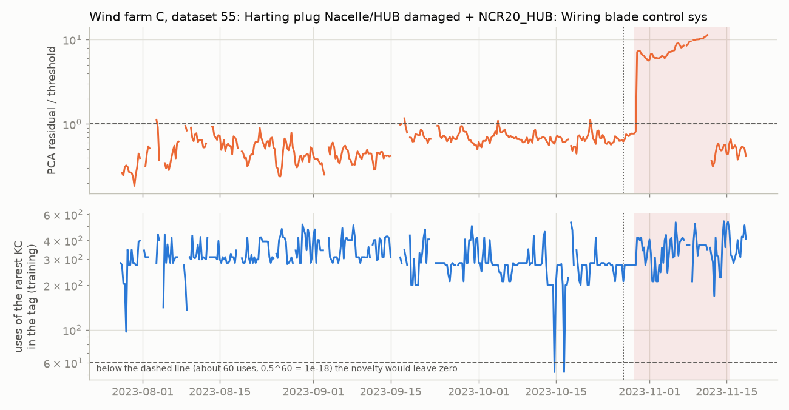
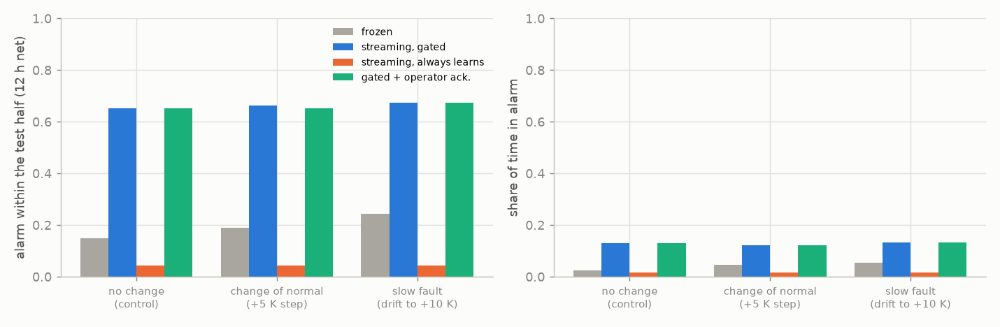
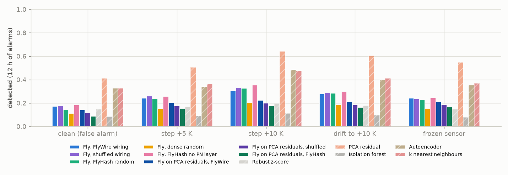
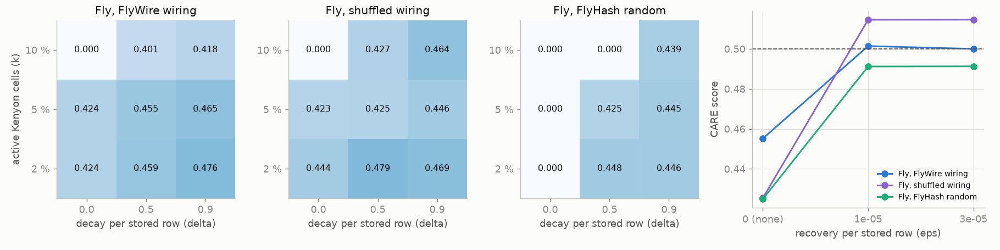
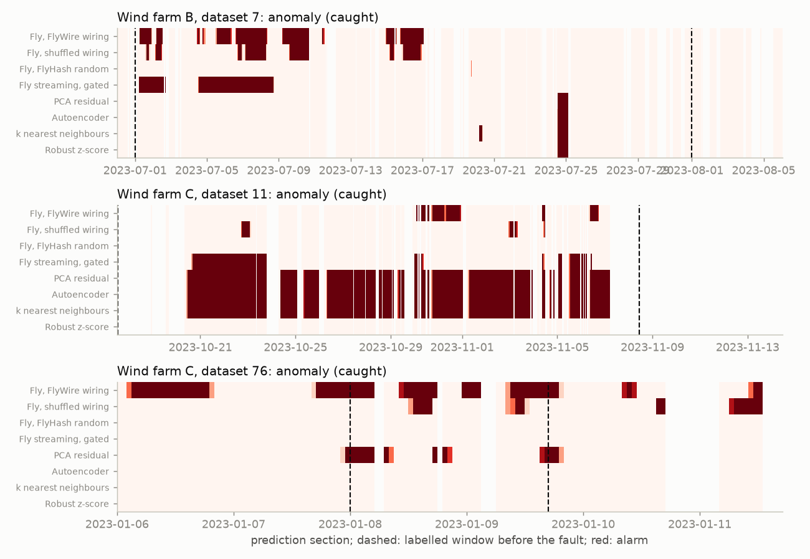
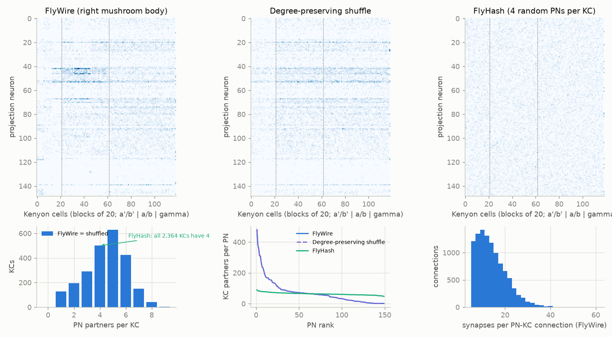

# A fruit fly's novelty detector on wind turbine SCADA

[](https://github.com/kwwaleszczynski-del/fly-novelty-scada/actions/workflows/ci.yml)

A fruit fly knows whether a smell is new with a few hundred neurons, no training loop and almost no memory: a
sparse random expansion into Kenyon cells, a winner-take-all, and synapses that tire when the same pattern comes
back. Computer science knows the same trick as a Bloom filter. This repository puts that circuit to work on a
real operational problem, **early fault detection on wind turbines from 10-minute SCADA data**, and asks three
questions:

1. **Does it find faults?** On the public **CARE to Compare** benchmark (95 datasets from three wind farms, 45 of
   them leading up to a logged fault), with the same protocol as standard detectors: isolation forest,
   autoencoder, PCA, k nearest neighbours, a robust z-score, and the temperature normal behaviour models of a
   companion project.
2. **Does the real wiring help?** The expansion uses the actual projection neuron (PN) to Kenyon cell (KC) wiring of
   the right mushroom body from the **FlyWire** connectome (149 PNs, 2,364 KCs, 10,505 connections), against the
   same wiring shuffled with all degrees kept, FlyHash's uniform random sampling, and a dense random projection.
3. **Is it a good operational tool?** Memory and time per sample, learning sample by sample, seasonal drift, the
   behaviour after a service changes what "normal" looks like, and a live replay of a stream.

A negative answer counts as much as a positive one here, and that is mostly what came out.

**Interactive dashboard:** the wiring, the alarms on real faults, a live replay with the Kenyon cells that
light up, and the method comparison -
[kwwaleszczynski-del.github.io/fly-novelty-scada](https://kwwaleszczynski-del.github.io/fly-novelty-scada/).

## Key results

**1. On CARE to Compare the fly detector hardly ever raises an alarm, and nothing here separates faults from
normal operation.** Same protocol for every method (fit on the first 75 % of the training year, threshold at the
99.5 % quantile of the remaining 25 %, trailing 6 h median, 12 hours of net alarms count as a detection):

| Method | CARE score | Faults detected (of 45) | Normal datasets flagged (of 50) | Skill | Median lead [days] |
|---|---|---|---|---|---|
| **Fly, FlyWire wiring** | 0.30 (0.00-0.46) | 1.3 | 1 | +0.01 | 7 |
| Fly, shuffled wiring | 0.43 (0.42-0.44) | 1.3 | 1.7 | 0.00 | 17 |
| Fly, FlyHash random | 0.44 (0.42-0.48) | 2 | 0.7 | +0.03 | 5 |
| Fly, dense random | 0.41 (0.40-0.42) | 0.3 | 1 | -0.01 | 29 |
| Fly, FlyHash no PN layer | 0.47 (0.44-0.49) | 3.7 | 1.7 | +0.05 | 7 |
| Fly on PCA residuals, FlyWire | 0.28 (0.00-0.42) | 0.7 | 0 | +0.01 | 30 |
| Fly on PCA residuals, shuffled | 0.44 (0.43-0.46) | 1.7 | 0 | +0.04 | 29 |
| Fly on PCA residuals, FlyHash | 0.00 | 0 | 0 | +0.00 | - |
| Robust z-score | 0.48 | 6 | 3 | +0.07 | 13 |
| PCA residual | 0.50 | 12 | 14 | -0.01 | 14 |
| Isolation forest | 0.45 | 3 | 3 | +0.01 | 8 |
| Autoencoder | 0.49 | 10 | 13 | -0.04 | 16 |
| k nearest neighbours | 0.51 | 11 | 13 | -0.02 | 17 |
| Fly streaming, gated | 0.50 | 15 | 21 | -0.09 | 19 |
| Fly streaming, always learns | 0.45 | 2 | 0 | +0.04 | 13 |
| Fly streaming FlyHash, gated | 0.49 | 18 | 22 | -0.04 | 20 |
| Fly streaming FlyHash, always learns | 0.45 | 2 | 0 | +0.04 | 13 |
| RC thermal model (temps only) | 0.47 | 3 | 2 | +0.03 | 16 |
| Gradient boosting NBM (temps only) | 0.49 | 5 | 2 | +0.07 | 16 |

*Fly rows: mean of three seeds (range in brackets). Skill = share of the 45 faults detected minus share of the 50
normal datasets flagged. The two temperature models are copied from the companion project (same datasets and
protocol). For orientation, the benchmark paper reports 0.66 for its own tuned autoencoder.*



- **No method finds faults at this fixed protocol.** The ones that alarm often (PCA, autoencoder, k nearest
  neighbours, the gated streaming fly) catch 10-18 of the 45 faults, but flag 13-22 of the 50 normal datasets as
  well; their CARE scores of about 0.5 are what a random detector gets. The ones that alarm rarely (z-score, the
  companion project's temperature models) are slightly better than chance (skill +0.03 to +0.07). The CARE score
  itself is unforgiving at the low end: a method that catches no fault at all scores 0, which is why the fly rows
  jump between 0 and 0.46 from one seed to the next.
- **The frozen fly detector catches 0-5 faults and flags 0-3 normal datasets per seed.** It is quiet, not
  discriminating. Feeding it the PCA residuals instead of the state does not change that (0-3 faults).

**2. The real wiring does not help.** FlyWire against the same wiring shuffled with all degrees kept: CARE -0.13 (95
% interval -0.29 to +0.03); against FlyHash: -0.14 (95 % interval -0.30 to +0.02) (differences of the seed means, 95
% intervals from resampling the datasets). Both random wirings catch as many faults (1.3 and 2.0 of 45 against 1.3).
The one variant that does a little better is FlyHash without the PN bottleneck (3.7 faults), i.e. less like the fly.
On the synthetic faults below, with far more trials, the picture is the same: FlyWire vs shuffled -0.005 (-0.027 to
+0.016), vs FlyHash -0.030 (-0.060 to -0.002) in skill (FlyHash slightly better), while sparse beats dense (+0.035
(+0.007 to +0.065)).

**3. Why: one year of SCADA overflows a 2,364-cell Bloom filter.** A Bloom filter needs more cells than stored
items (the 2018 paper uses 10 bits per item); here 30,000 training rows with 118 active KCs each are stored in
2,364 KCs, about 1,500 tag entries per KC. After a year every KC but one has been active, the median KC 1,312
times. A fault that moves the turbine into a combination of states that is new for an engineer still activates
KCs that are familiar: the winner-take-all keeps the strongest KCs, and the strongest KCs for "more of a familiar
deviation" are the same as for the familiar deviation. The fly is built to tell a new odour from a known one, not
a stronger dose of a known one. Wind farm C, dataset 55 (damaged plug and wiring of the blade control system): the
PCA residual rises to ten times its threshold, while the rarest KC in each tag was still active 200-400 times in
training (the novelty would need below about 60):



**4. Operation: cheap and fast, but its memory is the problem.** On wind farm B (34 signals) the fly detector fits
in 1.1 s, scores 26,120 rows per second in batch (38 µs per row) and scores and learns one sample in 0.57 ms. Its
model state is 232 kB (quantile tables of the encoder, the sparse wiring and 38 kB of learned KC weights; the
implementation keeps a dense float32 copy of the wiring, 1.4 MB, for speed). For comparison: PCA 4 kB and 32 µs per
sample, autoencoder 42 kB / 244 µs, k nearest neighbours 2.7 MB / 728 µs, isolation forest 1.2 MB / 11 ms
(`results/care/cost.csv`). Of these only the fly learns online by design, in O(k) per sample. Learning sample by
sample works technically, but none of the three ways to keep learning helps. In the six weeks after a change, on the
training data of all 95 datasets (synthetic +5 K step in one component temperature, as after a sensor swap, a slow
drift to +10 K, and a control without any change):

| Policy | No change (control) | +5 K step (change of normal) | Drift to +10 K (slow fault) |
|---|---|---|---|
| Frozen (stores nothing after the training year) | 15% | 19% | 24% |
| Streaming, learns only while not in alarm | 65% | 66% | 67% |
| Streaming, always learns | 4% | 4% | 4% |
| Gated + operator acknowledgement after the service | 65% | 65% | 67% |

*Share of the trials (one random component temperature in each of the 95 datasets) with an alarm (12 h net)
in the test half of the calibration rows (median 45 days).*

The gated streaming filter (learns only while not in alarm, with recovery so that old states fade) raises an alarm
in 65 % of the six-week windows even when nothing changed: recovery makes states that were not seen for a few
weeks new again, and a gated filter in alarm stops learning. A filter that always learns habituates to everything,
including the slow fault (4 % of trials). The frozen filter reacts a little to the drift (24 % against 15 % in the
control). An operator acknowledgement after a service changes nothing, because the +5 K step itself is rarely
noticed. On CARE the gated filter catches the most faults of all (15 of 45) but flags 21 of the 50 normal datasets.



**5. Synthetic faults (label-free).** Two random component temperatures per dataset, all 95 datasets, training
sections only (no labels), the four faults injected one at a time into the second half of the calibration rows;
share of the trials with an alarm (12 h net), and on the clean data (false):

| Method | Clean (false) | Step +5 K | Step +10 K | Drift to +10 K | Frozen sensor | Skill |
|---|---|---|---|---|---|---|
| Fly, FlyWire wiring | 17% | 24% | 30% | 28% | 24% | +0.095 |
| Fly, shuffled wiring | 18% | 26% | 33% | 29% | 24% | +0.100 |
| Fly, FlyHash random | 14% | 24% | 33% | 28% | 23% | +0.125 |
| Fly, dense random | 11% | 15% | 20% | 18% | 15% | +0.060 |
| Fly, FlyHash no PN layer | 18% | 26% | 35% | 30% | 25% | +0.107 |
| Fly on PCA residuals, FlyWire | 14% | 20% | 22% | 21% | 21% | +0.072 |
| PCA residual | 41% | 51% | 64% | 61% | 55% | +0.164 |
| Autoencoder | 33% | 34% | 48% | 40% | 35% | +0.067 |
| k nearest neighbours | 33% | 36% | 47% | 41% | 37% | +0.078 |
| Isolation forest | 8% | 9% | 11% | 9% | 8% | +0.009 |
| Robust z-score | 15% | 17% | 19% | 18% | 15% | +0.025 |

Skill = mean detection over the four faults minus the clean rate. Here the fly does better than on CARE: its
variants come second to fifth after PCA, ahead of k nearest neighbours and the autoencoder (within the noise for
those two), with far fewer false alarms than PCA (17 % against 41 % of the clean six-week windows; the clean rates
are high for every method because the test half is six weeks later than the half that sets the threshold).
Per-dataset differences of the skill, 95 % intervals over datasets: FlyWire vs shuffled -0.005 (-0.027 to +0.016),
vs FlyHash -0.030 (-0.060 to -0.002), vs dense +0.035 (+0.007 to +0.065), vs PCA -0.070 (-0.115 to -0.027), vs
autoencoder +0.028 (-0.004 to +0.060).



**6. Sensitivity (computed after the main results, changed nothing).** For the first seed of the real, shuffled and
FlyHash wiring: 2, 5 or 10 % active KCs, decay 0, 0.5 or 0.9, and recovery switched on while storing the training
year. A slower decay (0.9) with fewer active KCs (2 %) lifts the real wiring to 0.48 (5 faults, 3 normal datasets).
Recovery while storing the training year lifts every wiring to 0.49-0.52, but only by turning the fly into one more
detector that alarms often: 11-12 faults and 11-13 normal datasets, like PCA. The binary Bloom filter (decay 0)
catches at most 2 faults and flags no normal dataset.



Example alarm timelines (the dashboard has more, and the live replay):



## How the fly does it

The fly answers "have I smelled this before?" in two steps in its mushroom body (Dasgupta, Stevens, Navlakha 2017;
Dasgupta, Sheehan, Stevens, Navlakha 2018):

1. **Tag (FlyHash).** About 50 types of projection neurons carry a normalised odour pattern. They fan out to about
   2,000 Kenyon cells; each KC sums a handful of PNs. Feedback inhibition through one giant neuron (APL) leaves only
   the ~5 % most excited KCs active. The active set is the odour's tag: a sparse, high-dimensional,
   locality-sensitive hash, so similar odours get overlapping tags.
2. **Habituation (fly Bloom filter).** Every KC has an output synapse onto the novelty neuron MBON-α'3. When an odour
   is experienced the synapses of its active KCs weaken and the others slowly recover (Hattori et al. 2017). The
   novelty neuron's response, the summed weight of the active KCs' synapses, is high for a new odour and falls as
   it becomes familiar.

Here the odour is a turbine's 10-minute state vector $`x`$ (every 10-minute average the farm logs, except angles
and counters: power, wind, speeds, pitch, currents, voltages, pressures and all temperatures; 28-37 signals on wind
farms A and B, 113-131 on C after removing near-duplicates):

```math
\begin{aligned}
c &= \mathrm{code}(x) && \text{population code: 4 tuning curves per signal, summing to 1}\\
p &= M c - \bar{p} && \text{149 PNs; } M \text{ assigns the channels to PNs, } \bar{p} \text{ is the training mean}\\
a &= \tilde{W} p && \text{2,364 KCs; } \tilde{W} \text{: PN to KC weights, every row scaled to unit length}\\
T(x) &= \text{the } k = 118 \text{ KCs with the largest } a_i && \text{winner-take-all, 5 \% of the KCs}\\
\nu(x) &= \frac{1}{k} \sum_{i \in T(x)} w_i && w_i \in [0, 1]: \text{KC to MBON weights}
\end{aligned}
```

and storing a row changes the weights as in Eq. 2 of the 2018 paper:

```math
w_i \leftarrow \begin{cases} \delta \, w_i & i \in T(x) \\ \min(1,\ w_i + \varepsilon) & \text{otherwise} \end{cases}
\qquad \delta = 0.5
```

The design choices, each applied to every wiring variant alike:

- **Population code.** Winner-take-all only sees the direction of its input, not its size, so a bearing 2 or 8
  standard deviations too hot would get the same tag. Each signal is first mapped to a normal score through its
  training quantiles and then coded by four Gaussian tuning curves (centres -2.25, -0.75, 0.75, 2.25; the outer ones
  open-ended). Every signal contributes one unit of input, like the fly's normalised PN activity, and how extreme a
  value is shows up as which channel is active. More tuning curves (8, 12) made things worse in the development
  test.
- **The PN bottleneck.** The 112-524 channels go through the 149 real PNs: a seeded balanced random map, so on wind
  farms A and B a channel drives one or two PNs, on C a PN sums three or four channels (a broadly tuned
  glomerulus). The same seed gives the same map to every wiring variant.
- **PN adaptation and KC compensation.** With raw synapse counts the few KCs with many strong claws win every time,
  the filter saturates on them and nothing looks new. PN input is therefore centred on its training mean, and every
  KC's weight row is scaled to unit length: KCs need several active claws to fire (Gruntman & Turner 2013) and
  KCs with more input are less excitable (compensatory variability, Abdelrahman et al. 2021). The relative synapse
  counts within a KC are kept.
- **Storing the training year.** With $`\varepsilon = 0`$ the weights are $`w_i = \delta^{n_i}`$, $`n_i`$ = how often
  KC $`i`$ was in a stored tag; the order does not matter. Common states have $`n_i`$ in the thousands, so a row's
  novelty comes from the rarely used KCs in its tag. Recovery ($`\varepsilon = 10^{-5}`$ per stored row, a fully
  habituated KC is new again after 100,000 rows or 2-3 years) is switched on only for streaming operation; switched
  on while storing the training year it makes the filter forget the start of that year (development test below).
- **Streaming.** From the calibration rows on, the streaming variant scores a row, decides the alarm and then
  stores the row if the turbine is producing in normal status (on wind farm A, whose prediction-section status
  comes from the failure log, only if producing, so the log cannot tell the filter when to stop learning); the gated
  variant stores nothing while in alarm. Its threshold is set from its own scores on the calibration rows.
- **Alarm.** The raw novelty is smoothed with a trailing 6-hour median over producing rows and compared with the
  99.5 % quantile of the smoothed score on the calibration rows (which the frozen variants never store), exactly
  as for every other method.

The fly's learned state is one weight per KC (2,364 float64 numbers, plus a last-touched counter per KC for the
lazy recovery: 38 kB); the wiring is fixed.

## The real wiring



*Top: share of the KCs in each block of 20 (grouped by class: α'/β', α/β, γ) that receive input from each PN.
Bottom: PN partners per KC, KC partners per PN, synapses per connection. Derived from FlyWire v783 (CC BY 4.0).*

From the FlyWire connectome (v783) and its cell-type annotations, every antennal lobe projection neuron (ALPN) with
at least 5 synapses onto a right-hemisphere Kenyon cell is kept: 149 PNs (120 uniglomerular, 7 from the left side)
and 2,364 of the 2,597 right KCs, 10,505 connections with 143,275 synapses, 98.6 % of them in the right calyx. A KC
gets input from 4.4 PNs on average (5 % have one, 5 % seven or more), which is the claw count FlyHash copies. The
wiring is far from uniform: PN popularity is skewed (one DP1m PN reaches 480 KCs, the median PN 57), and some
glomeruli prefer KC classes (DM1, DM2, DM4 PNs connect 1.6-1.9 times more often to α/β KCs than the shuffle
predicts), the structured sampling described by Zheng et al. 2022.

The variants, all with the same input, the same 2,364 KCs and the same 5 % winner-take-all:

| Variant | PN to KC matrix | What it tests |
|---|---|---|
| **FlyWire** | the real synapse counts | the fly's own wiring |
| **Shuffled** | the real matrix after degree-preserving edge swaps: every KC keeps its number of PN partners and its synapse counts, every PN its number of KCs | whether the specific pairings matter beyond the degree structure |
| **FlyHash** | every KC sums 4 PNs drawn uniformly, weight 1 (Dasgupta et al. 2017) | whether the degree structure and weights matter |
| **Dense** | dense Gaussian random projection | sparse vs dense expansion |
| **FlyHash, no PN layer** | every KC samples 6 of the 112-524 channels directly | the cost of squeezing the signals through 149 PNs |

## Data and protocol

**CARE to Compare** (Gück, Roelofs, Faulstich 2024;
[doi:10.5281/zenodo.15846963](https://doi.org/10.5281/zenodo.15846963), CC BY-SA 4.0) holds 95 datasets from three
wind farms (A: onshore, 5 turbines, 22 datasets, 86 columns; B and C: offshore, 15 and 58 datasets with 257 and 957
columns). Each dataset is one turbine's 10-minute SCADA with about a year of training data and a prediction section
that contains either a labelled window leading up to a logged fault (45 datasets) or normal operation (50). The
archive is read directly from the zip; nothing of it is in this repository.

The protocol is the one of the companion project
[wind-thermal-nbm](https://github.com/kwwaleszczynski-del/wind-thermal-nbm), so its temperature models can be put
next to these:

- **fitting rows:** the first 75 % of the training section, normal status, producing more than 5 % of rated power;
  **calibration rows:** the remaining 25 %, never used for fitting; every detector is then frozen;
- **alarm:** trailing 6-hour median of the raw score over producing rows, flagged above the 99.5 % quantile of the
  calibration rows (fixed in the companion project before any prediction section was looked at);
- **score:** the CARE score of the benchmark paper (coverage, accuracy, reliability, earliness; 0.5 is what a
  random detector reaches; a fault counts as detected after 12 hours of net alarms before it happens), with the
  companion project's implementation, which matches the authors' reference code to 4 decimals.

The baselines see the same state vector, standardised with the training mean and standard deviation:
**robust z-score** (largest absolute z over signals), **PCA** (squared reconstruction error outside the components
that explain 95 % of the variance), **isolation forest** (100 trees of 256 samples), **autoencoder** (MLP with a
bottleneck, 3 hidden layers), **k nearest neighbours** (mean distance to the 5 nearest of 10,000 stored training
rows; the exact version of what the fly Bloom filter approximates, Eq. 1 of the 2018 paper). The companion
project's **RC thermal model** and **gradient-boosting NBM** use only the temperature channels and are copied from
its results.

Every design choice of the fly detector was made without the CARE labels: on synthetic data, and on a
**development test** that injects synthetic faults into the training sections of 18 datasets (6 per farm, fixed
random subset) and counts detections against false alarms on the clean data (`results/care/dev_*.csv`):
4 tuning curves beat 8 and 12, and no recovery while storing the training year beat recovery. The sensitivity grid
on CARE was computed after the main results and changed nothing. One exception: the fly on PCA residuals was added
after the development test had put PCA ahead, by which time the first 12 CARE datasets had been scored and showed
the same; it is reported like every other variant (and did not help).

## The honest answer

- **Does it find faults?** Not on CARE to Compare at this protocol: the frozen fly detector catches almost nothing
  and alarms almost never. On synthetic temperature faults it is a reasonable detector (second to PCA, with fewer
  false alarms), so the circuit works; it is the kind of fault and the amount of history that defeat it.
- **Does the real wiring help?** No. With the same input, the FlyWire PN to KC matrix is as good as the same matrix
  shuffled with all degrees kept, and slightly worse than FlyHash's uniform sampling, on CARE and on 760 synthetic
  fault trials. What helps is what FlyHash and the fly share: a sparse expansion with winner-take-all (sparse beats
  dense) and no bottleneck that mixes many signals into one PN. The structure that the real wiring adds (popular
  "food" glomeruli, KC-class preferences) encodes the statistics of odours, which mean nothing for a turbine's
  signals; the mapping of signals to PNs is arbitrary, so this test can only check structural properties.
- **Is it a good operational tool?** The machinery is: 38 kB of learned state, about half a millisecond per sample
  including learning, no training loop, and learning one sample at a time. The memory is not: a Bloom filter
  of 2,364 cells is full after a year of 10-minute data, and the recovery that keeps it from filling up turns
  passing time into alarms. A fly needs to remember a few hundred odours; a turbine produces 50,000 states a year.

What would be needed to change that: many more Kenyon cells (to keep about one tag entry per cell, millions for a
year of data), storing only rows that are new (the fly stores everything it smells), or feeding the fly something
other than the raw state, for example the alarms of a normal behaviour model, where "this pattern of deviating
signals has never been seen" is exactly the question an operator asks.

## Limitations

- **The protocol is fixed and simple** (one threshold quantile, a 6-hour median, the 12-hour criticality of CARE)
  and none of the detectors was tuned on CARE. The benchmark paper reaches 0.66 with its own tuned autoencoder;
  better thresholds would move every method here, not only the fly.
- **CARE's faults are mixed**: hydraulics, pitch, converters, plugs and wiring next to bearings and transformers,
  logged in different ways on three farms, many of them invisible in 10-minute averages. 45 faults make the CARE
  score noisy, which the seed ranges and intervals show.
- **The synthetic faults** are offsets, drifts and frozen values in one component temperature; real faults are often
  slower, smaller or spread over several signals. The clean false-alarm rates there are high for every method
  because the test half lies six weeks after the half that sets the threshold.
- **The biology is simplified**: firing rates instead of spikes, one novelty neuron, no APL dynamics, a population
  code chosen for SCADA, PN adaptation and KC compensation as two scalings. The channel to PN map is random, so the
  real glomerular identities carry no meaning here.
- **The cost numbers** are from one laptop and one dataset (34 signals); the single-sample time is mostly Python
  overhead.

## Reproduce

```bash
python -m venv .venv && .venv/bin/pip install -e ".[dev]"   # Windows: .venv\Scripts\pip
pytest -q                                   # offline tests on synthetic data (no downloads)
python -m fly_novelty fetch                 # FlyWire annotations (27 MB) + connections (852 MB); only for `connectome`
python -m fly_novelty connectome            # rebuild connectome/ (committed, so this step is optional)
python -m fly_novelty fetch-care            # CARE to Compare, 5.5 GB (CC BY-SA 4.0)
python -m fly_novelty care --jobs 6         # all methods on the 95 datasets (about 50 min on 12 threads)
python -m fly_novelty inject --jobs 6       # synthetic faults in the training sections (about 40 min)
python -m fly_novelty inject --dev --jobs 6 # the development tests that fixed the design
python -m fly_novelty service --jobs 6      # change of normal vs slow fault, four learning policies
python -m fly_novelty cost                  # memory and time per sample
python -m fly_novelty replay --farm B --event 7    # one prediction section streamed live, alarms logged
python -m fly_novelty report                # figures, tables and docs/index.html
```

`CARE_ZIP` and `FLYWIRE_DATA_DIR` point to existing copies of the data instead of `data/`.

## Repository layout

| Path | Content |
|---|---|
| `src/fly_novelty/encoding.py` | quantile Gaussianisation and the population code |
| `src/fly_novelty/expansion.py` | channel to PN map, PN to KC matrices (FlyWire, shuffled, FlyHash, dense, no PN layer) |
| `src/fly_novelty/novelty.py` | winner-take-all tags, the fly Bloom filter with lazy recovery, streaming replay, the detector |
| `src/fly_novelty/connectome.py` | extraction of the PN to KC wiring from FlyWire |
| `src/fly_novelty/baselines.py` | z-score, PCA, isolation forest, autoencoder, k nearest neighbours |
| `src/fly_novelty/care.py`, `care_score.py` | the CARE protocol and score |
| `src/fly_novelty/inject.py` | synthetic faults in the training sections |
| `src/fly_novelty/operational.py` | cost, change of normal, live replay |
| `src/fly_novelty/report.py`, `dashboard.html` | figures and the dashboard |
| `connectome/` | derived PN to KC wiring (CC BY 4.0, see its README) |
| `results/care/` | scores, tables and figures derived from CARE to Compare (CC BY-SA 4.0, see its LICENSE) |
| `docs/` | GitHub Pages dashboard (its CARE-derived data are CC BY-SA 4.0) |

## Sources

- S. Dasgupta, C. F. Stevens, S. Navlakha: *A neural algorithm for a fundamental computing problem*. Science 358,
  793-796 (2017), [doi:10.1126/science.aam9868](https://doi.org/10.1126/science.aam9868) - FlyHash.
- S. Dasgupta, T. C. Sheehan, C. F. Stevens, S. Navlakha: *A neural data structure for novelty detection*. PNAS 115,
  13093-13098 (2018), [doi:10.1073/pnas.1814448115](https://doi.org/10.1073/pnas.1814448115) - the fly Bloom filter.
- D. Hattori et al.: *Representations of novelty and familiarity in a mushroom body compartment*. Cell 169,
  956-969 (2017) - MBON-α'3 as a novelty neuron.
- S. J. C. Caron, V. Ruta, L. F. Abbott, R. Axel: *Random convergence of olfactory inputs in the Drosophila mushroom
  body*. Nature 497, 113-117 (2013), [doi:10.1038/nature12063](https://doi.org/10.1038/nature12063).
- Z. Zheng et al.: *Structured sampling of olfactory input by the fly mushroom body*. Current Biology 32, 3334-3349
  (2022), [doi:10.1016/j.cub.2022.06.031](https://doi.org/10.1016/j.cub.2022.06.031).
- E. Gruntman, G. C. Turner: *Integration of the olfactory code across dendritic claws of single mushroom body
  neurons*. Nature Neuroscience 16, 1821-1829 (2013), [doi:10.1038/nn.3547](https://doi.org/10.1038/nn.3547).
- N. Y. Abdelrahman, E. Vasilaki, A. C. Lin: *Compensatory variability in network parameters enhances memory
  performance in the Drosophila mushroom body*. PNAS 118, e2102158118 (2021),
  [doi:10.1073/pnas.2102158118](https://doi.org/10.1073/pnas.2102158118).
- S. R. Olsen, V. Bhandawat, R. I. Wilson: *Divisive normalization in olfactory population codes*. Neuron 66,
  287-299 (2010).
- **FlyWire connectome:** FlyWire Consortium, *FlyWire Whole-brain Connectome Connectivity Data* v783, Zenodo
  [doi:10.5281/zenodo.10676866](https://doi.org/10.5281/zenodo.10676866), CC BY 4.0; S. Dorkenwald et al.: *Neuronal
  wiring diagram of an adult brain*, Nature 634, 124-138 (2024); P. Schlegel et al.: *Whole-brain annotation and
  multi-connectome cell typing of Drosophila*, Nature 634, 139-152 (2024) (annotations v2.1.0, CC BY 4.0).
- **CARE to Compare:** C. Gück, C. Roelofs (Fraunhofer IEE), *Wind Turbine SCADA Data For Early Fault Detection*,
  Zenodo [doi:10.5281/zenodo.15846963](https://doi.org/10.5281/zenodo.15846963), CC BY-SA 4.0; C. Gück, C. M. A.
  Roelofs, S. Faulstich: *CARE to Compare: A Real-World Benchmark Dataset for Early Fault Detection in Wind Turbine
  Data*, Data 9(12), 138 (2024), [doi:10.3390/data9120138](https://doi.org/10.3390/data9120138).

## Licences

Code: MIT (`LICENSE`). `connectome/` is derived from FlyWire data and annotations and is CC BY 4.0, as is
`docs/img/pn_kc_wiring.png`. Everything in `results/care/` and the data embedded in `docs/index.html` are derived
from CARE to Compare and are CC BY-SA 4.0. No raw SCADA data or connectome tables are in the repository.
